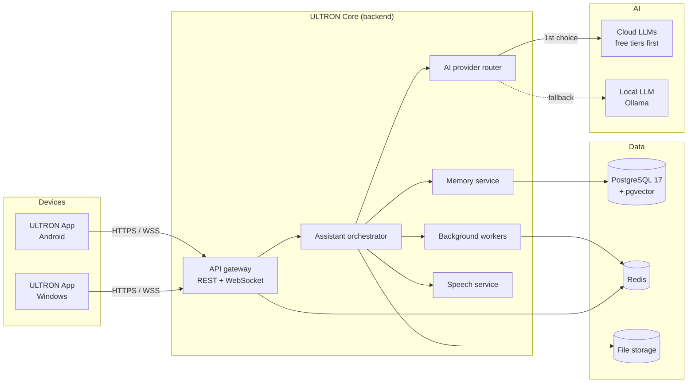
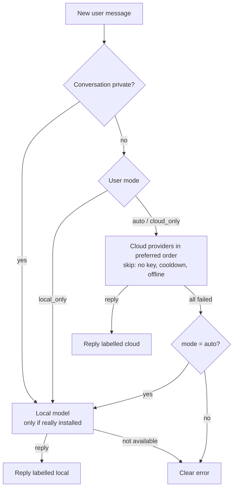

# ULTRON Architecture

> **Status: APPROVED (2026-11-09).** Phases 1 (backend foundation) and 2
> (Intelligence Engine) are built and tested — see
> [`PROJECT_STATUS.md`](../PROJECT_STATUS.md) and the
> [roadmap](DEVELOPMENT_ROADMAP.md). Security: [`SECURITY.md`](SECURITY.md).
> Decisions are recorded in [`docs/adr/`](adr/); connectivity, offline mode
> and sync are specified in [`docs/SYNC.md`](SYNC.md).

ULTRON is an advanced personal AI assistant for **Android** and **Windows**.

## 1. Guiding principles

1. **Free and open source first.** Every required component is free/OSS.
   Paid services are optional add-ons, never required.
2. **Cloud-first, local-fallback.** Use cloud resources when they're
   available and within free limits; fall back to local resources
   automatically when they aren't (offline, rate-limited, quota used,
   or the request is marked private).
3. **Local by default during development.** PostgreSQL and Redis run in
   Docker Compose on the developer machine. No cloud account is needed to
   start.
4. **Supabase is optional.** ULTRON talks to plain PostgreSQL. A dedicated
   ULTRON Supabase project can be plugged in later as the cloud database.
5. **Separate databases, no automatic switching.** Local and cloud database
   settings are separate; exactly one is used, chosen by config. Moving data
   follows the sync strategy in [SYNC.md](SYNC.md).
6. **Strict project isolation.** ULTRON shares no database, deployment,
   credentials or environment variables with any other project
   ([ADR-0004](adr/0004-project-isolation.md)).

## 2. System overview



## 3. Components

### 3.1 ULTRON App (client)
- **One codebase for Android and Windows** using Flutter.
- Chat UI, voice input/output, notifications, settings.
- **Local SQLite cache** (via `drift`) holds recent conversations, settings
  and an **outbox** of actions taken while offline, synced when back online.
- Talks to ULTRON Core over HTTPS (REST) and WebSocket (streamed replies).

### 3.2 ULTRON Core (backend)
Python 3.12 + FastAPI, one deployable service plus a worker process.

| Module | Responsibility |
|---|---|
| API gateway | REST + WebSocket endpoints, auth, rate limiting (Redis) |
| Assistant orchestrator | Conversation flow, tool/skill calling, context assembly |
| AI provider router | Chooses a model provider per request; handles fallback |
| Memory service | Long-term memory: facts, notes, embeddings (pgvector) |
| Speech service | Speech-to-text and text-to-speech |
| Background workers | Reminders, scheduled tasks, long jobs (Redis-backed queue) |

### 3.3 Data layer

| Store | Used for | Local (now) | Cloud (later, optional) |
|---|---|---|---|
| PostgreSQL 17 + pgvector | Users, devices, conversations, memory, tasks | Docker Compose | New ULTRON-only Supabase project |
| Redis | Cache, rate limits, job queue, pub/sub for streaming, short-term context | Docker Compose | Any Redis-compatible host |
| File storage | Voice clips, attachments | Local folder / volume | S3-compatible (e.g. Supabase Storage) |
| SQLite (on device) | Offline cache + outbox | In the app | — |

**Schema management:** SQLAlchemy 2 + Alembic migrations. The same
migrations run against local Postgres and a future Supabase project — this
is what keeps Supabase optional. Migrations never run against the cloud
database unless `ULTRON_ALLOW_CLOUD_MIGRATIONS=true` is set for that command.

### 3.4 AI provider router (built in Phase 2)
Code: `apps/core/src/ultron_core/ai/`. Decision: [ADR-0007](adr/0007-ai-provider-router.md).



| Provider | Adapter | Cost |
|---|---|---|
| Groq, Google Gemini, OpenRouter, custom | OpenAI-compatible HTTP (httpx) | Free tiers (optional) |
| Anthropic Claude | Official `anthropic` SDK, server-side refusal fallback | Paid (optional) |
| Ollama | Native `/api/chat`, `/api/tags` | Free, local |
| Dev mock | In-process | Development only |

- **Failure categories** drive routing: not configured, auth, rate limited,
  quota exhausted, unavailable, offline, model not installed, invalid
  request, refused. Rate limits/quota/outages put a provider on a cooldown
  (Redis).
- **Offline:** a connection failure skips the remaining cloud providers and
  goes straight to local AI.
- **Honest local AI:** Ollama counts as available only when the configured
  model is actually installed (`/api/tags`).
- **Private:** local only, never cloud ([SECURITY.md](SECURITY.md) §3).
- **No stitching:** if a provider fails after text has streamed, the reply
  is saved as `incomplete`, not continued by another model.
- **Labelling:** every reply stores and returns provider, `cloud`/`local`,
  model, `fallback_used` and the attempts made.

### 3.5 Chat system (built in Phase 2)
Code: `apps/core/src/ultron_core/chat/`.

| Endpoint | Purpose |
|---|---|
| `POST/GET /api/v1/conversations` | Create (optionally private) / list |
| `GET/PATCH/DELETE /api/v1/conversations/{id}` | Read with messages / rename or make private / delete (tombstone) |
| `POST /api/v1/conversations/{id}/messages` | Send; JSON reply, or SSE stream with `"stream": true` |
| `POST /api/v1/conversations/{id}/cancel` | Stop the reply being generated |
| `GET /api/v1/ai/status` | Which providers can answer now (no secrets) |
| `GET/PUT /api/v1/ai/preferences` | Mode, cloud order, private by default |

- **Streaming (SSE):** `message.created` → `provider.selected` → `delta`… →
  `message.completed` | `message.cancelled` | `error`.
- **Context:** completed messages only, newest first until the provider's
  character budget (cloud 48k, local 16k by default) or 40 messages; never
  starts with an assistant turn; same-role turns merged.
- **Generation:** each reply runs as its own task; cancelling the task (the
  cancel endpoint or a client disconnect) stores the partial reply as
  `cancelled`. One reply at a time per conversation.
- **Message states:** `streaming`, `complete`, `incomplete`, `failed`,
  `cancelled`; replies left `streaming` by a crash are marked failed at startup.
- **Tables:** `conversations`, `messages` (ordered by `seq`),
  `user_ai_preferences` (migration `0002`).

### 3.6 Speech
- Speech-to-text: **faster-whisper** (MIT), runs locally; cloud STT optional.
- Text-to-speech: **Piper** (open source; verify the current fork's licence
  at adoption); Android/Windows built-in TTS as zero-cost fallback.

## 4. Cloud-first, local-fallback in practice

| Layer | Cloud (preferred) | Local fallback |
|---|---|---|
| AI inference | Cloud LLM providers (free tiers first) | Ollama on the Windows PC / server |
| Backend reachability | Cloud-hosted ULTRON Core (future) | Windows local backend on the LAN → then on-device offline mode |
| Data | Supabase ULTRON project (future, optional) | Local Docker Postgres + Redis (current default) |
| Client data | Server is source of truth | SQLite cache + outbox, synced on reconnect |

**Databases never fail over automatically.** `ULTRON_DB_MODE` picks **one**
database per backend. Offline resilience comes from device caches and
outboxes, synced with idempotent operations when connectivity returns
([SYNC.md](SYNC.md), [ADR-0005](adr/0005-sync-and-no-automatic-db-switching.md)).

**Platform notes**
- *Windows:* runs the full local backend (Docker Desktop: Postgres, Redis,
  ULTRON Core) and local AI models (Ollama, native install recommended for
  GPU, or the `local-ai` Compose profile).
- *Android:* cannot run Docker. Its fallback is the PC/LAN backend, then
  offline mode (cached data, queued actions, on-device TTS/STT). An
  on-device small model can be evaluated later.

## 5. Configuration & secrets
- All settings come from environment variables prefixed `ULTRON_`.
- `.env.example` (committed, placeholders only) → copy to `.env`
  (git-ignored).
- `ULTRON_DB_MODE=local|cloud` selects the database
  (`ULTRON_LOCAL_DATABASE_URL` / `ULTRON_CLOUD_DATABASE_URL`).
- No secrets in code, Docker images, or git history.

## 6. Security (single-user personal assistant)
- One owner account created from the CLI; Argon2id password hashing.
- Per-device short-lived JWT access tokens + rotating refresh tokens with
  reuse detection; devices can be revoked instantly
  ([ADR-0006](adr/0006-authentication.md)).
- Login rate limiting in Redis.
- Local services bind to `127.0.0.1` only; LAN exposure for the Android
  app will be designed explicitly in Phase 3.
- Private-mode requests never reach cloud providers.
- Row-level security policies added if/when Supabase is connected.

## 7. Technology choices (free / open source)

| Concern | Choice | Licence |
|---|---|---|
| Client (Android + Windows) | Flutter / Dart | BSD-3-Clause |
| On-device storage | SQLite + drift | Public domain / MIT |
| Backend | Python 3.12, FastAPI | PSF / MIT |
| ORM + migrations | SQLAlchemy 2, Alembic | MIT |
| Database | PostgreSQL 17 + pgvector | PostgreSQL Licence |
| Cache / queue | Redis 8 (or Valkey, drop-in) | AGPLv3 option (Valkey: BSD) |
| Job queue | arq | MIT |
| Local LLM runtime | Ollama | MIT |
| Speech-to-text | faster-whisper | MIT |
| Text-to-speech | Piper | Open source |
| Containers | Docker Compose | Apache-2.0 |
| CI | GitHub Actions | Free tier |

## 8. Planned repository layout

```
ultron-ai-assistant/
├── apps/
│   ├── core/                 # ULTRON Core backend (Python, FastAPI)  [Phase 1 ✓]
│   │   ├── src/ultron_core/  # app, config, auth, db, migrations
│   │   ├── tests/            # unit + integration tests
│   │   └── Dockerfile
│   └── client/               # ULTRON App (Flutter: Android + Windows) [Phase 3]
├── infra/postgres/init/      # Local DB bootstrap (extensions only)
├── docs/                     # Architecture, sync design, ADRs, setup
├── .github/workflows/        # CI (lint, tests, image build)
├── docker-compose.yml        # Local backend: Postgres, Redis, Core (+ Ollama)
├── .env.example              # ULTRON-only config template
└── PROJECT_STATUS.md         # Current phase and test results
```

## 9. Delivery phases

| Phase | Scope | Status |
|---|---|---|
| 0 | Foundation: docs, Docker Compose (Postgres + Redis), env template, repo hygiene | **Done** |
| 1 | ULTRON Core: config, health, Postgres, Redis, migrations, auth, logging, tests, CI, Docker | **Done** |
| 2 | AI provider router (cloud free tier → Ollama fallback) + chat API with streaming | **Done** |
| 3 | Flutter app (Windows + Android): chat UI, device pairing, backend selection, offline cache/outbox, sync endpoints | Awaiting approval |
| 4 | Long-term memory (pgvector), voice (STT/TTS), reminders/workers | — |
| 5 | Optional: connect a new ULTRON Supabase project; choose cloud hosting (not Netlify) | — |

## 10. Explicitly out of scope (by decision)
- Creating a Supabase project now.
- Any access to, or reuse of, other projects' Supabase or Netlify resources.
- Deploying ULTRON to Netlify, or using Netlify at all.
- Automatic switching between databases.
