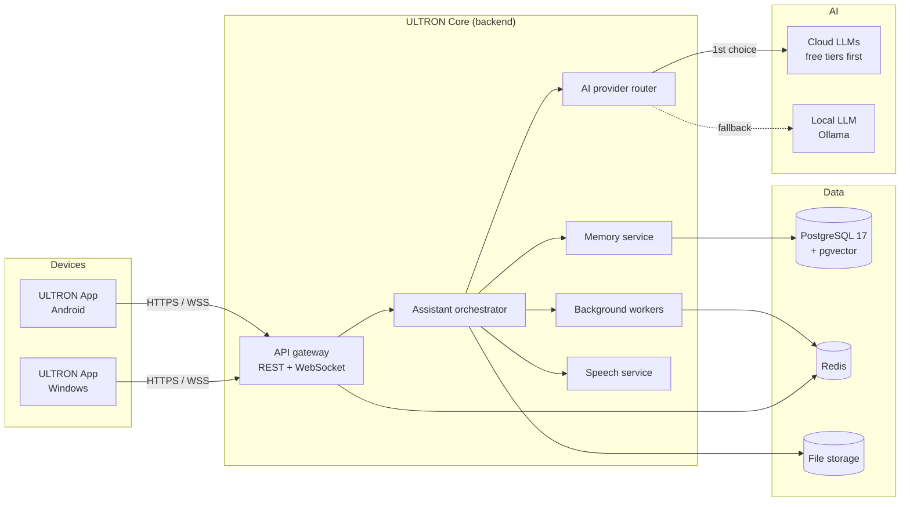

# ULTRON Architecture

> **Status: PROPOSED — awaiting approval.** Nothing beyond the Phase 0
> foundation is built yet. Decisions are recorded in [`docs/adr/`](adr/).

ULTRON is an advanced personal AI assistant for **Android** and **Windows**.

## 1. Guiding principles

1. **Free and open source first.** Every required component is free/OSS.
   Paid services are optional add-ons, never required.
2. **Cloud-first, local-fallback.** Use cloud resources when they're
   available and within free limits; fall back to local resources
   automatically when they aren't (offline, rate-limited, quota used,
   or the request is marked private).
3. **Local by default during development.** PostgreSQL and Redis run in
   Docker Compose on the developer machine. No cloud account is needed to
   start.
4. **Supabase is optional.** ULTRON talks to plain PostgreSQL. A dedicated
   ULTRON Supabase project can be plugged in later by changing config only.
5. **Strict project isolation.** ULTRON shares no database, deployment,
   credentials or environment variables with any other project
   ([ADR-0004](adr/0004-project-isolation.md)).

## 2. System overview



## 3. Components

### 3.1 ULTRON App (client)
- **One codebase for Android and Windows** using Flutter.
- Chat UI, voice input/output, notifications, settings.
- **Local SQLite cache** (via `drift`) holds recent conversations, settings
  and an **outbox** of actions taken while offline, synced when back online.
- Talks to ULTRON Core over HTTPS (REST) and WebSocket (streamed replies).

### 3.2 ULTRON Core (backend)
Python 3.12 + FastAPI, one deployable service plus a worker process.

| Module | Responsibility |
|---|---|
| API gateway | REST + WebSocket endpoints, auth, rate limiting (Redis) |
| Assistant orchestrator | Conversation flow, tool/skill calling, context assembly |
| AI provider router | Chooses a model provider per request; handles fallback |
| Memory service | Long-term memory: facts, notes, embeddings (pgvector) |
| Speech service | Speech-to-text and text-to-speech |
| Background workers | Reminders, scheduled tasks, long jobs (Redis-backed queue) |

### 3.3 Data layer

| Store | Used for | Local (now) | Cloud (later, optional) |
|---|---|---|---|
| PostgreSQL 17 + pgvector | Users, devices, conversations, memory, tasks | Docker Compose | New ULTRON-only Supabase project |
| Redis | Cache, rate limits, job queue, pub/sub for streaming, short-term context | Docker Compose | Any Redis-compatible host |
| File storage | Voice clips, attachments | Local folder / volume | S3-compatible (e.g. Supabase Storage) |
| SQLite (on device) | Offline cache + outbox | In the app | — |

**Schema management:** SQLAlchemy 2 + Alembic migrations. The same
migrations run against local Postgres and a future Supabase project — this
is what keeps Supabase optional.

### 3.4 AI provider router
A single interface (`generate`, `stream`, `embed`, `transcribe`) with
pluggable providers, tried in a configurable order:

1. **Cloud, free tier** — e.g. Google Gemini API, Groq, OpenRouter free
   models (each optional, enabled only when its key is set).
2. **Cloud, paid (optional)** — e.g. Anthropic Claude, OpenAI. Off unless
   configured.
3. **Local fallback** — Ollama with an open-weight model
   (e.g. Llama / Qwen / Gemma; check each model's licence).

Fallback triggers: no network, timeout, HTTP 429 / quota exhausted,
provider error, or request flagged **private** (private requests go
local-only and never leave the machine). Free-tier limits change often, so
the router treats them as runtime signals rather than hard-coded numbers.

### 3.5 Speech
- Speech-to-text: **faster-whisper** (MIT), runs locally; cloud STT optional.
- Text-to-speech: **Piper** (open source; verify the current fork's licence
  at adoption); Android/Windows built-in TTS as zero-cost fallback.

## 4. Cloud-first, local-fallback in practice

| Layer | Cloud (preferred) | Local fallback |
|---|---|---|
| AI inference | Cloud LLM providers (free tiers first) | Ollama on the Windows PC / server |
| Backend reachability | Cloud-hosted ULTRON Core (future) | ULTRON Core on the local PC/LAN → then on-device offline mode |
| Data | Supabase ULTRON project (future, optional) | Local Docker Postgres + Redis (current default) |
| Client data | Server is source of truth | SQLite cache + outbox, synced on reconnect |

**Not promised:** automatic two-way failover between a cloud database and a
local database. That needs a sync engine and is out of scope. Server-side
`ULTRON_DB_MODE` picks **one** primary database; offline resilience comes
from the client cache + outbox.

**Platform notes**
- *Windows:* can run the full stack locally (Docker Desktop + Ollama),
  so it gets a complete local fallback.
- *Android:* cannot run Docker. Its fallback is the PC/LAN backend, then
  offline mode (cached data, queued actions, on-device TTS/STT). An
  on-device small model can be evaluated later.

## 5. Configuration & secrets
- All settings come from environment variables prefixed `ULTRON_`.
- `.env.example` (committed, placeholders only) → copy to `.env`
  (git-ignored).
- `ULTRON_DB_MODE=local|supabase` selects the database.
- No secrets in code, Docker images, or git history.

## 6. Security (single-user personal assistant)
- Device pairing: each device gets its own revocable token (JWT).
- Local services bind to `127.0.0.1` only; LAN exposure for the Android
  app will be designed explicitly in Phase 3.
- Private-mode requests never reach cloud providers.
- Row-level security policies added if/when Supabase is connected.

## 7. Technology choices (free / open source)

| Concern | Choice | Licence |
|---|---|---|
| Client (Android + Windows) | Flutter / Dart | BSD-3-Clause |
| On-device storage | SQLite + drift | Public domain / MIT |
| Backend | Python 3.12, FastAPI | PSF / MIT |
| ORM + migrations | SQLAlchemy 2, Alembic | MIT |
| Database | PostgreSQL 17 + pgvector | PostgreSQL Licence |
| Cache / queue | Redis 8 (or Valkey, drop-in) | AGPLv3 option (Valkey: BSD) |
| Job queue | arq | MIT |
| Local LLM runtime | Ollama | MIT |
| Speech-to-text | faster-whisper | MIT |
| Text-to-speech | Piper | Open source |
| Containers | Docker Compose | Apache-2.0 |
| CI | GitHub Actions | Free tier |

## 8. Planned repository layout

```
ultron-ai-assistant/
├── apps/
│   ├── core/            # ULTRON Core backend (Python, FastAPI)   [Phase 1]
│   └── client/          # ULTRON App (Flutter: Android + Windows) [Phase 3]
├── infra/
│   └── postgres/init/   # Local DB bootstrap (extensions only)    [done]
├── docs/
│   ├── ARCHITECTURE.md  # This document                           [done]
│   ├── DEVELOPMENT.md   # Local setup                             [done]
│   └── adr/             # Architecture decision records           [done]
├── docker-compose.yml   # Local Postgres + Redis                  [done]
└── .env.example         # ULTRON-only config template             [done]
```

## 9. Delivery phases

| Phase | Scope | Status |
|---|---|---|
| 0 | Foundation: docs, Docker Compose (Postgres + Redis), env template, repo hygiene | **Done** |
| 1 | ULTRON Core skeleton: config loading, health endpoint, DB + Redis connections, Alembic, tests, CI | Awaiting approval |
| 2 | AI provider router (cloud free tier → Ollama fallback) + basic chat API with streaming | — |
| 3 | Flutter app (Windows + Android): chat UI, device pairing, offline cache/outbox | — |
| 4 | Long-term memory (pgvector), voice (STT/TTS), reminders/workers | — |
| 5 | Optional: connect a new ULTRON Supabase project; choose cloud hosting (not Netlify) | — |

## 10. Explicitly out of scope (by decision)
- Creating a Supabase project now.
- Any access to, or reuse of, other projects' Supabase or Netlify resources.
- Deploying ULTRON to Netlify.
