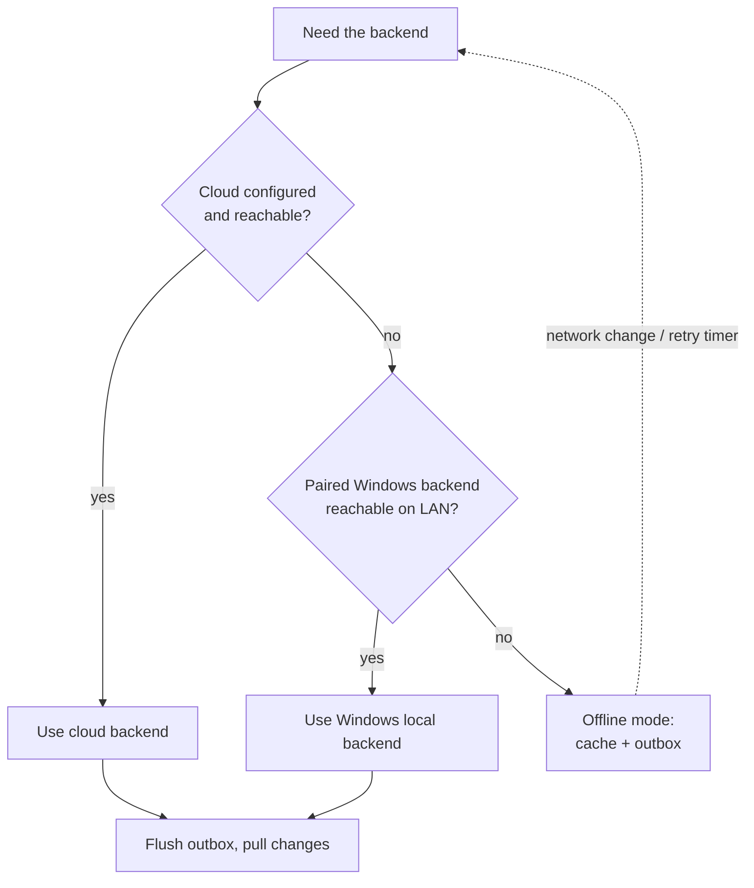

# ULTRON connectivity, offline mode and synchronisation

> **Status:** Design approved in principle for Phase 1. Foundations are
> built (see "What exists today"); the sync endpoints and client outbox are
> implemented in Phase 3b, and the cloud/edge split in Phase 5.

## 1. Goals

1. Android stays useful offline: cached data is readable and new work is
   queued.
2. When connectivity returns, queued work is applied **exactly once** and
   nothing is lost silently.
3. Cloud and local databases stay separate. ULTRON **never switches
   databases automatically**; moving data between them is a deliberate,
   documented procedure (section 9).

## 2. Nodes and roles

| Node | Database | Role |
|---|---|---|
| Cloud backend (Phase 5) | Cloud DB (new ULTRON-only Supabase project) | **Primary**: source of truth once it exists |
| Windows local backend | Local Docker Postgres | **Primary today**; becomes an **edge** node once a cloud primary exists |
| Android / Windows app | On-device SQLite | Client cache + outbox |

Rules:
- There is exactly **one primary** at any time. It is chosen by
  configuration, never by runtime failover.
- An edge node is a client of the primary: it keeps its own database as a
  cache plus a queue of pending operations, and syncs them to the primary
  with the same protocol as a device.
- Each backend reports its identity on `GET /health/live`:
  `deployment` (`cloud`/`local`), `node_id`, `api_version`.

## 3. How Android chooses a backend

- **Probe:** `GET /health/live` with a short timeout (≈3 s). Accept the node
  only if `api_version` is compatible and `node_id` matches the node the
  device was paired with (prevents talking to an impostor on the LAN).
- **Order:** cloud first, then the Windows local backend, then offline.
- **Re-check:** on Android network-change events, and on a backoff timer
  (e.g. 30 s → 5 min) while not on the preferred node. The app moves back to
  the cloud when it becomes reachable again.
- **No mid-operation switching:** one sync session (push + pull) runs
  against one node from start to finish.
- **Pairing is per node:** a device pairs (logs in) with each backend
  separately, so tokens from one node are never valid on another.
- **LAN security (Phase 3b):** the Windows backend is reachable from the
  phone only when the owner sets `ULTRON_CORE_BIND_HOST`; pairing will pin
  the backend's TLS certificate fingerprint (shown as a QR code).

## 4. What Android can do offline

| Works offline | Needs a backend |
|---|---|
| Read cached conversations, notes, tasks, reminders, settings | New AI replies (until an on-device model is added) |
| Create/edit/complete notes, tasks and reminders | Data from other devices |
| Local reminders fire via the Android scheduler | Device management, account changes |
| Queue "ask ULTRON later" requests | |
| Change settings | |

## 5. Data rules for synchronised tables

- **Client-generated IDs:** UUIDs (v7 preferred) are created where the record
  is created, so offline records keep their identity.
- **`version`:** integer bumped by the server on every update (SQLAlchemy
  `version_id_col`, already in place). Used for optimistic concurrency.
- **`deleted_at`:** deletes are tombstones, so they sync like any other change.
- **`change_seq`:** a server-side increasing sequence on every write; clients
  pull "changes since cursor N".
- **Device clocks are never used for ordering** (phone clocks drift). The
  server's order of receipt decides.

## 6. Push: the outbox

Every local change is first written to the device's outbox:

| Field | Purpose |
|---|---|
| `op_id` (UUIDv7) | Idempotency key |
| `entity`, `entity_id` | What changed |
| `op` | `create` / `update` / `delete` |
| `base_version` | The version the change was made against |
| `patch` | Only the fields that changed |

Delivery:
1. The device sends outbox entries **in order**, in batches.
2. The server applies each operation **in its own transaction** and records
   `op_id` in a `sync_applied_ops` table (unique). A replayed `op_id`
   returns the original result and changes nothing, so retries are safe
   (at-least-once delivery + idempotency = exactly-once effect).
3. Per operation the server answers `applied` (new version), `conflict`
   (server state attached) or `rejected` (validation error).
4. An outbox entry is removed **only after** the server confirms it.
   Rejected entries are parked for the user, never dropped.
5. Retries use exponential backoff with jitter.

## 7. Pull: the change feed

`GET /api/v1/sync/changes?cursor=N` returns changes ordered by
`change_seq` and a new cursor. The device applies them to its cache, then
re-applies any of its own still-pending outbox changes on top, so the user
never sees their unsent edits disappear.

## 8. Conflict policy

| Data | Policy |
|---|---|
| Append-only (chat messages, history, logs) | Cannot conflict; merged by id |
| Settings / preferences | Field-level last-writer-wins, in server receipt order |
| Notes, tasks, reminders | Different fields changed → merged automatically. Same field changed on both sides → server value kept, the device's value saved as a **conflict copy** and shown to the user |
| Edit vs. delete | Delete wins; the edit is kept as a conflict copy |

Nothing is ever discarded silently.

## 9. Safety rules

1. **No automatic database switching.** `ULTRON_DB_MODE` is fixed at
   startup. If the configured database is down, the backend reports
   `not_ready` (HTTP 503) and keeps using the same configuration.
2. **Schema gate:** sync requests carry the client's schema/API version. An
   incompatible client is refused (it keeps its outbox and asks to update).
3. **Idempotent writes everywhere** (op ids).
4. **Atomic operations:** each operation commits fully or not at all.
5. **Revoked devices** cannot sync. Their outbox stays on the device and the
   user is told.
6. **Cloud migrations are explicit:** they require
   `ULTRON_ALLOW_CLOUD_MIGRATIONS=true` for that one command, and the Docker
   container never auto-migrates a cloud database.

## 9a. Private conversations

Private conversations (AI on local models only) are stored only by a local
backend with a local database and are **never pushed to a cloud primary**.
When the cloud/edge split arrives (Phase 5), the edge keeps them local and
excludes them from its outbox to the cloud. See [SECURITY.md](SECURITY.md) §3.

## 10. Moving from the local database to a cloud database (deliberate)

Done once, when a cloud ULTRON project exists (Phase 5):

1. Create a **new** Supabase project for ULTRON only.
2. Apply migrations to it explicitly
   (`ULTRON_ALLOW_CLOUD_MIGRATIONS=true ultron-core migrate`).
3. Put the local primary into maintenance mode (no writes); devices keep
   queueing in their outboxes.
4. Copy the ULTRON database (`pg_dump` → `pg_restore`), then verify row
   counts and checksums.
5. Start the cloud backend with `ULTRON_DB_MODE=cloud`; it becomes the primary.
6. Switch the Windows backend to the edge role (its local database becomes a
   cache), and devices pair with the cloud node.
7. Keep the old local database untouched until the move is verified
   (rollback = point back at it).

## 11. What exists today (Phase 1)

- Separate `ULTRON_LOCAL_DATABASE_URL` / `ULTRON_CLOUD_DATABASE_URL`, one
  selected by `ULTRON_DB_MODE`, with no fallback (enforced by config validation
  and tests).
- UUID primary keys and `version` columns with optimistic locking.
- Backend identity on `/health/live` (`deployment`, `node_id`, `api_version`).
- Per-device tokens (devices are the unit of pairing and revocation).
- Cloud migration safety catch.

Still to build: the outbox and change feed (`sync_applied_ops`,
`change_seq`, `/sync` endpoints) in Phase 3b; the edge role in Phase 5.
